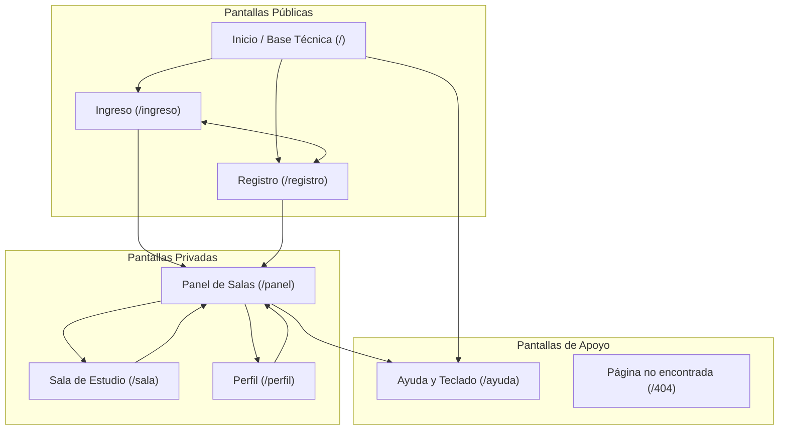

# 1. Fundamentación UX/HCI: Investigación, Personas, Mapa del Sitio, Glosario y Flujos (T1–T4)

Documento de diseño centrado en el usuario (DCU) para **StudyRoom — Salón de Estudio Colaborativo en Tiempo Real**, alineado con los criterios **`S0-C01`** y **`S0-C02`** de la rúbrica oficial del Sprint 0.

---

## 1. Investigación con Usuarios: Resumen de Entrevistas y Encuesta Corta (`S0-C01`)

Para fundamentar las *User Personas* en datos reales (evitando perfiles inventados), se aplicó una **encuesta corta a 12 estudiantes universitarios** de Ingeniería y Ciencias, complementada con **3 entrevistas semiestructuradas** de 15 minutos sobre cómo estudian en grupo de forma remota.

### Hallazgos Principales de la Encuesta y Entrevistas
1. **Entrevista 1 (Estudiante de 6.º semestre con discapacidad visual / uso de NVDA):**
   - *Cómo estudia en grupo:* Se reúne por llamadas de voz para repasar código y teoría antes de los parciales.
   - *Qué le molesta de las herramientas actuales (Discord, Meet, Zoom):* Exceso de botones sin etiqueta textual («botón sin nombre»), paneles flotantes que cambian de lugar, pérdida del foco del teclado al abrir el chat y falta de avisos por voz cuando alguien entra, silencia su micrófono o comparte pantalla.
2. **Entrevista 2 (Monitor académico de Cálculo y Algoritmos):**
   - *Cómo estudia en grupo:* Crea sesiones de 3 a 6 compañeros donde resuelve ejercicios compartiendo pantalla y enviando fórmulas por el chat.
   - *Qué le molesta de las herramientas actuales:* Cuando se cierra la llamada en Google Meet, **se pierde todo el historial del chat** con los enlaces y apuntes de la sesión; además, aplicaciones como Teams consumen demasiada memoria RAM en portátiles estudiantiles.
3. **Entrevista 3 (Estudiante de 4.º semestre con conexión doméstica inestable):**
   - *Cómo estudia en grupo:* Alterna entre voz y chat de texto cuando su ancho de banda baja.
   - *Qué le molesta de las herramientas actuales:* Mensajes de error genéricos («Error de red») que no explican cómo reconectarse ni permiten seguir usando el chat cuando falla el video.
4. **Resultados cuantitativos de la encuesta ($n = 12$):**
   - **83,3 %** prefiere iniciar sesión con su correo institucional o cuenta de Google en un solo clic sin captchas visuales complejos.
   - **91,7 %** considera indispensable que el **historial del chat quede guardado** al volver a entrar a una Sala.
   - **75,0 %** usa simultáneamente **voz + pantalla compartida + chat** durante la preparación de exámenes.

---

## 2. User Personas (`S0-C01`)

### Persona 1: Valentina Ríos — Estudiante Universitaria con Ceguera Total (Foco Accesibilidad)
- **Edad:** 21 años | **Programa:** Ingeniería de Sistemas (6.º semestre)
- **Tecnología de asistencia:** Lector de pantalla **NVDA** en Windows y navegación exclusiva por **teclado** (`Tab`, `Shift+Tab`, `Enter`, `Espacio`, navegación por regiones `D` y encabezados `H`).
- **Cómo estudia en grupo:** Se conecta por las noches con 2 o 3 compañeros para repasar algoritmos y preparar entregas.
- **Qué necesita:**
  - Autenticarse sin barreras cognitivas ni captchas visuales (`WCAG 3.3.8`).
  - Unirse de forma autónoma a una **Sala** mediante código o desde su **Panel**.
  - Leer y enviar mensajes en el **Chat** sabiendo quién escribió sin perder el foco del campo de texto.
  - Activar o silenciar su micrófono y compartir pantalla con confirmación auditiva inmediata (`aria-live` / `aria-pressed`).
- **Qué le molesta de las herramientas actuales:**
  - Botones de solo ícono sin nombre accesible (`aria-label`).
  - Mensajes nuevos o errores de validación que aparecen visualmente pero no son anunciados por el lector de pantalla.
  - Trampas de teclado en ventanas emergentes o pérdida de foco al cambiar de vista.

### Persona 2: Mateo Gómez — Estudiante que Lidera Grupos de Estudio
- **Edad:** 22 años | **Programa:** Matemáticas Aplicadas e Ingeniería
- **Contexto de uso:** Portátil de gama media y celular; organiza sesiones de estudio de 3 a 6 integrantes antes de cada parcial.
- **Cómo estudia en grupo:** Crea una **Sala** por materia, comparte el código por WhatsApp a su grupo, presenta su pantalla con ejercicios y deja enlaces en el **Chat**.
- **Qué necesita:**
  - Crear, editar y eliminar **Salas** privadas rápidamente y ver qué compañeros están conectados en tiempo real.
  - Que el **Chat** conserve el historial persistente en base de datos para repasar los apuntes días después.
  - Ver claramente quién tiene cámara activa, micrófono silenciado o pantalla compartida.
- **Qué le molesta de las herramientas actuales:**
  - Que el chat desaparezca al terminar la videollamada (como ocurre en Meet/Zoom).
  - Interfaces saturadas de menús que distraen de la sesión de estudio.

---

## 3. Organización del Producto: Mapa del Sitio, Navegación y Glosario (`S0-C02`)

### 3.1 Clasificación de Pantallas del Mapa del Sitio
Todas las pantallas están implementadas en la estructura base de rutas del frontend:

1. **Pantallas Públicas (acceso sin sesión):**
   - **Inicio (`/`)**: Pantalla de bienvenida y verificación en vivo de la Base Técnica End-to-End con Cloud Firestore (`TS-00`).
   - **Ingreso (`/ingreso`)**: Inicio de sesión con cuenta de Google o correo institucional y contraseña.
   - **Registro (`/registro`)**: Creación de cuenta estudiantil nueva.
2. **Pantallas Privadas (requieren estudiante autenticado):**
   - **Panel (`/panel`)**: Directorio de Salas del estudiante, creación de Sala nueva e ingreso rápido por código.
   - **Sala (`/sala`)**: Espacio síncrono con **Chat** persistente, controles de **Audio/Video** y **Compartir pantalla**.
   - **Perfil (`/perfil`)**: Visualización, edición de datos de cuenta y eliminación de cuenta con ventana de confirmación.
3. **Pantallas de Apoyo (transversales):**
   - **Ayuda (`/ayuda`)**: Guía de atajos de teclado y pautas de accesibilidad WCAG 2.2 Nivel AA.
   - **Página no encontrada (`/404` o cualquier ruta inexistente)**: Pantalla de error 404 con explicación clara y botón directo para volver a **Inicio** o **Ingreso**.

### 3.2 Cómo se Navega y Cómo se Vuelve Atrás
- **Menú de Navegación Principal (`<nav aria-label="Navegación principal del mapa del sitio">`)**: Ubicado en el encabezado común (`<header>`), permite ir directamente a las vistas principales e indica la página actual mediante `aria-current="page"` y resaltado en color primario (`#D32F2F`).
- **Cómo se vuelve atrás**:
  - Dentro de una **Sala (`/sala`)**, el botón explícito **«Salir de la Sala»** regresa al **Panel (`/panel`)** cerrando las pistas de audio/video.
  - En **Perfil (`/perfil`)**, **Ayuda (`/ayuda`)** y **Página no encontrada (`/404`)**, existe siempre un botón primario **«Volver al Inicio»** o **«Volver al Panel»**, además de compatibilidad total con los botones Atrás/Adelante del navegador (`History API`).

### 3.3 Glosario Oficial de Nombres Consistentes (`S0-C02`)
Para cumplir con la heurística de *Consistencia y Estándares* (#4 de Nielsen), en todas las pantallas, botones, mensajes y documentación se utilizan **únicamente** los siguientes términos en español:

| Concepto | Término Único Aprobado en StudyRoom | Términos Prohibidos (No usar nunca) |
| :--- | :--- | :--- |
| Espacio virtual de reunión | **Sala** (o *Sala de Estudio*) | ~~Room~~, ~~Espacio~~, ~~Canal~~, ~~Aula~~, ~~Sesión~~ |
| Vista principal tras autenticar | **Panel** (o *Panel de Salas*) | ~~Dashboard~~, ~~Home privado~~, ~~Tablero~~, ~~Lobby~~ |
| Acción de entrar con cuenta | **Iniciar sesión** / Vista **Ingreso** | ~~Login~~, ~~Log in~~, ~~Sign in~~, ~~Entrar~~ |
| Acción de crear cuenta | **Registrarse** / Vista **Registro** | ~~Sign up~~, ~~Crear usuario~~, ~~Alta~~ |
| Mensajería de texto | **Chat** | ~~Mensajero~~, ~~Muro~~, ~~Foro~~, ~~Feed~~ |
| Presentar ventana o escritorio | **Compartir pantalla** | ~~Screen share~~, ~~Transmitir escritorio~~, ~~Proyectar~~ |
| Administración de datos propios | **Perfil** | ~~Mi cuenta~~, ~~Configuración~~, ~~Settings~~ |

---

## 4. Flujos de Usuario de las Tareas Núcleo (T1 a T4) Incluyendo Manejo de Errores (`S0-C01`)

### T1. Gestión de Identidad, Perfil y Salas (Camino Ideal + Qué pasa cuando algo sale mal)
1. **Camino ideal:** El estudiante entra a **Ingreso (`/ingreso`)**, elige **«Continuar con Google»** o ingresa su correo institucional y contraseña $\rightarrow$ la API valida el token con Firebase Admin SDK $\rightarrow$ redirige al **Panel (`/panel`)** $\rightarrow$ crea una **Sala**, edita su título, se une por código o edita/elimina su **Perfil**.
2. **Qué pasa cuando algo sale mal (Errores contemplados):**
   - **Credenciales inválidas o correo mal escrito:** Los campos se marcan con borde rojo (`#EF4444`), `aria-invalid="true"` y aparece debajo una alerta (`role="alert"`) con el texto: *«Correo o contraseña incorrectos. Verifica tus datos e intenta de nuevo»*.
   - **Nombre de usuario duplicado al registrarse o editar Perfil:** La transacción en Firestore rechaza el duplicado, la API responde `409 Conflict` y el formulario informa: *«Ese nombre de usuario ya está en uso. Elige otro diferente»*.
   - **Código de Sala inexistente o Sala eliminada:** Al intentar unirse, la API devuelve `404 Not Found` y el **Panel** muestra una alerta sin recargar la página: *«No existe una Sala con ese código. Verifica el código con tu compañero»*.

### T2. Chat en Tiempo Real e Historial Persistente (Camino Ideal + Errores)
1. **Camino ideal:** Al entrar a la **Sala (`/sala`)**, el frontend solicita a la API (`GET /api/rooms/:id/messages`) el historial guardado en Firestore y lo muestra ordenado cronológicamente. Cuando un estudiante envía un mensaje, viaja por Socket.IO (`chat:message`), se guarda en Firestore y se emite en vivo a los miembros de la misma **Sala**, anunciándose mediante `aria-live="polite"`.
2. **Qué pasa cuando algo sale mal:**
   - **Intento de enviar mensaje vacío:** El botón de envío permanece deshabilitado o previene el envío indicando que debe escribir texto.
   - **Pérdida temporal de conexión WebSocket:** Se muestra un aviso de estado (*«Reconectando al Chat...»*) y se bloquea temporalmente el envío para que ningún mensaje se pierda sin guardarse en Firestore.

### T3. Interacción Audio y Video WebRTC (Camino Ideal + Errores)
1. **Camino ideal:** En la **Sala (`/sala`)**, el estudiante activa su micrófono o cámara (`getUserMedia`), el servidor de tiempo real intercambia la señalización (`webrtc:signal`) y el resto de compañeros recibe el audio/video P2P y ve actualizado el indicador de micrófono/cámara.
2. **Qué pasa cuando algo sale mal:**
   - **Permiso de micrófono o cámara denegado en el navegador:** La aplicación **no se bloquea ni expulsa al estudiante de la Sala**; muestra una alerta clara (`role="alert"`): *«No se concedió permiso al micrófono/cámara. Puedes seguir participando mediante el Chat y escuchando a tus compañeros»*.
   - **Fallo de negociación P2P / NAT estricto:** Se utiliza el servidor STUN/TURN configurado por variables de entorno y se ofrece el botón **«Reintentar conexión de voz/video»**.

### T4. Compartición de Pantalla WebRTC (Camino Ideal + Errores)
1. **Camino ideal:** El estudiante presiona **«Compartir pantalla»** (`getDisplayMedia`), selecciona la ventana o pantalla completa y todos los integrantes de la **Sala** ven la transmisión y escuchan el anuncio de estado (*«[Nombre] está compartiendo pantalla»*).
2. **Qué pasa cuando algo sale mal:**
   - **El estudiante cancela el selector de ventana del navegador:** Se captura la excepción `NotAllowedError`, se mantiene el estado anterior sin romper la videollamada y se informa discretamente: *«Se canceló la selección de pantalla»*.
   - **El navegador en celular no soporta `getDisplayMedia`:** El botón **«Compartir pantalla»** se deshabilita con una explicación accesible indicando que en dispositivos móviles puede visualizar la pantalla compartida por sus compañeros.
